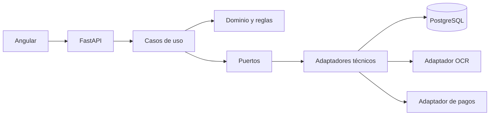

# Arquitectura del sistema

## Decisión
El MVP se construirá como un monolito modular con arquitectura hexagonal. FastAPI expondrá la API REST y PostgreSQL será la fuente de verdad. Angular consumirá los servicios REST. No se desplegarán microservicios ni un bus de eventos en la primera iteración.

## Vista general

## Módulos backend
- autenticacion: usuarios y roles.
- sedes: configuración de parqueaderos.
- carriles: entradas y salidas.
- vehiculos: placas y clasificación.
- reconocimiento_placas: lectura OCR y confianza.
- accesos: ingresos, salidas y autorización de barrera.
- tarifas: franjas, valores y vigencias.
- cobros: generación, estados y pase diario.
- pagos: caja y confirmación de pagos.
- cupos: disponibilidad por tipo de vehículo.
- auditoria: acciones manuales y cambios.
- reportes: consultas e indicadores.
- gateway: comunicación con el equipo local de la sede.

## Reglas de dependencia
1. Dominio no depende de frameworks ni infraestructura.
2. Aplicación coordina casos de uso y depende de puertos.
3. Infraestructura implementa persistencia e integraciones.
4. Presentación expone HTTP y valida contratos de entrada/salida.
5. Angular no replica las reglas de negocio del servidor.

## Evolución
Primera fase: una sede, simulación LPR, backend modular, PostgreSQL y pagos en caja. Después: OCR real, almacenamiento de imágenes, operación local sin conexión y pasarela de pagos. Separar servicios solo si existe una necesidad real de escala.
